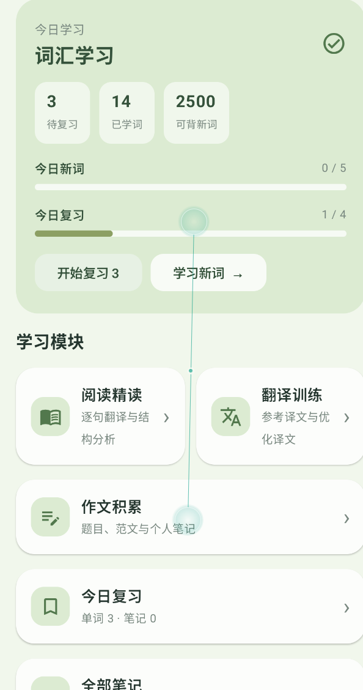
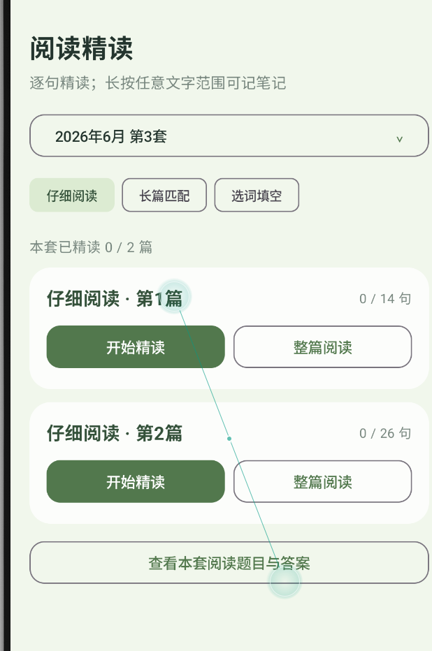
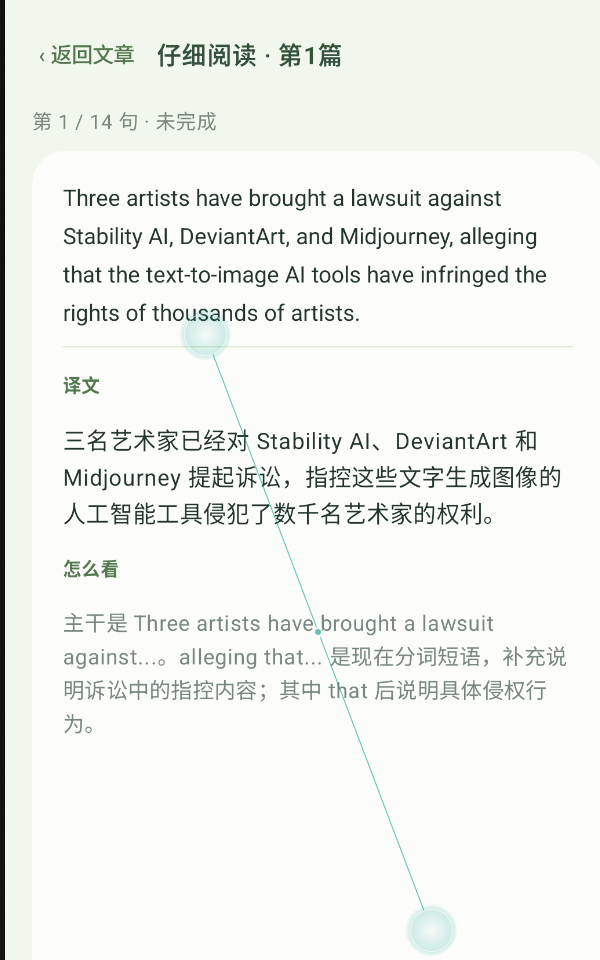
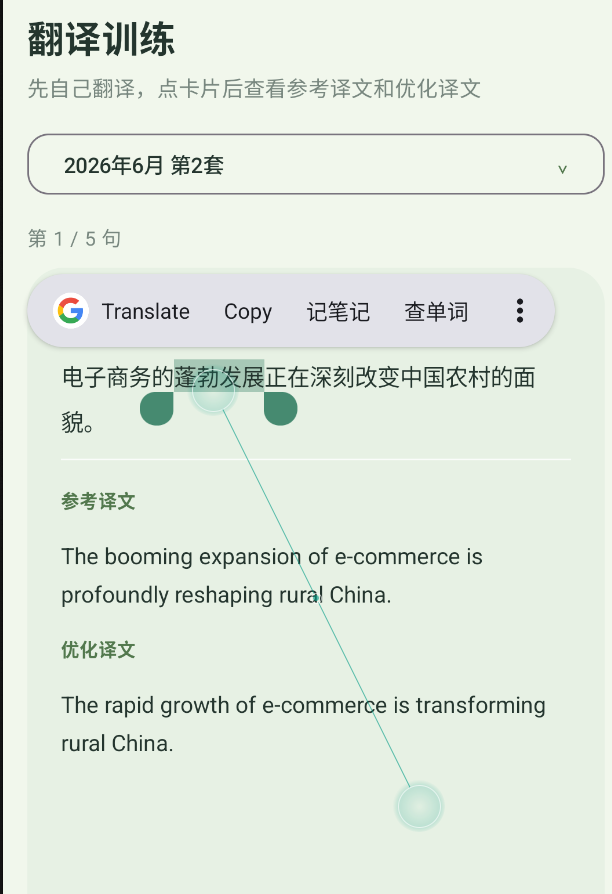

# LevelLeap · CET-6 六级学习 App

一款离线优先的英语六级学习 Android 应用，使用 Kotlin、Jetpack Compose、Room 和 SQLite。应用把词汇、阅读、翻译、写作和复习记录放在一个轻量的学习流程里。

## 功能一览

### 词汇学习
- 浏览词库中的六级词汇，并按单词或词义搜索。
- 查看词义、例句等词条内容；例句尚未补齐的词会标记为待补充，不会进入今日新词队列。
- 通过「不会 / 有点了解 / 熟悉 / 彻底熟悉」等记忆反馈安排学习与复习。
- 设置每日新词目标，在首页查看新词和到期复习进度。

### 阅读精读
- 按套题和练习类型选择阅读材料，包含仔细阅读、长篇匹配、选词填空等入口。
- 支持逐句精读和整篇阅读。
- 查看句子译文、结构分析及阅读题目答案。
- 长按文本可选中内容，便于记笔记或查词。

### 翻译训练
- 按套题练习六级翻译。
- 先自行翻译，再查看参考译文和优化译文。
- 可在练习文本中选词、复制或记录笔记。

### 作文积累
- 浏览写作题目、参考范文和优秀范文。
- 保存个人作文笔记，并在全部笔记中查看或编辑。

### 复习与本地数据
- 单词和笔记均有独立的复习队列。
- 复习到期按手机本地日期计算：间隔到期日的凌晨开始显示为应复习；跨过本地午夜后首页会切换到新一天的目标与进度。
- 学习状态、收藏、标记和笔记保存在独立的用户数据库中。升级内容库时会保留已有学习记录。
- 内容库是应用资源，可离线使用；本仓库不包含个人更新版数据库，需按下方说明自行替换。

## 应用截图

| 首页 | 阅读练习 |
| --- | --- |
|  |  |

| 逐句精读 | 翻译训练 |
| --- | --- |
|  |  |

## 在 Android Studio 中运行

1. 安装 Android Studio 和 JDK 17。
2. 克隆仓库并在 Android Studio 中打开项目根目录。
3. 等待 Gradle Sync 完成。
4. 连接 Android 手机或启动模拟器，选择 `app` 配置并运行。

应用包名为 `com.cet6.study`。更新版本使用相同包名；若通过 APK 覆盖安装，请沿用原来的签名。也可在 Android Studio 连接手机后直接运行。

## 替换个人内容数据库

如果你有更新后的 `CET6_LevelLeap_content_20261013_v39(1).db`：

1. 先备份整个项目以及手机上的学习数据。
2. 将该数据库复制到 `app/src/main/assets/`，并命名为 `cet6_content.db`，覆盖同名文件。
3. 保留代码中的 `app/src/main/assets/content_version.txt` 版本值，不要随意改名或删除。
4. 在 Android Studio 中重新运行，或构建并安装更新后的 APK。

学习进度、单词记忆状态和笔记保存在应用私有的用户数据库中，与内容库分开。使用相同包名和签名覆盖安装时，Android 会保留这些应用数据。不要在系统设置中清除应用数据，也不要卸载旧版后再安装。

## 项目结构

- `app/src/main/java/com/cet6/study/`：Compose 界面、学习流程和数据层
- `app/src/main/assets/cet6_content.db`：SQLite 内容库资源（个人版本需自行放入）
- `app/src/main/assets/content_version.txt`：内容库版本标识
- `app/src/test/`：复习日期逻辑单元测试

## 验证说明

复习日期逻辑的 5 项单元测试已通过。当前执行环境没有可用的 Android SDK，因此完整 Android 构建和真机安装仍需在 Android Studio 中验证。
